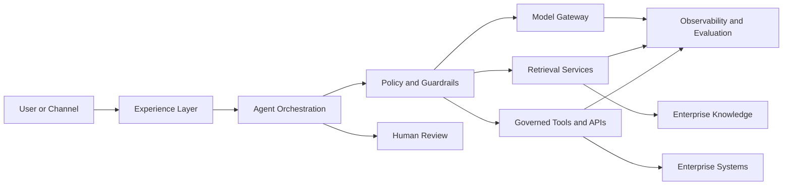

# AI Architect | Enterprise GenAI & Agentic Systems

I am a senior **AI and Solution Architect** with more than 20 years of experience designing secure, scalable enterprise solutions across artificial intelligence, cloud, integration, web, and mobile platforms.

My current work focuses on turning Generative AI capabilities into governed, production-ready enterprise platforms. I work across business, architecture, security, data, engineering, and operations to connect model capabilities with trusted knowledge, controlled actions, observability, resilience, and measurable outcomes.

> **Focus:** Enterprise AI architecture, Conversational AI, Agentic AI, multi-agent systems, RAG, secure AI integration, and cloud-native solution design.

## Core Capabilities

### AI & Agentic Architecture

- Generative AI and Conversational AI
- Large Language Models and Small Language Models
- Agentic AI and multi-agent systems
- Agent orchestration and supervisor patterns
- Tool calling and function calling
- Context and memory management
- Human-in-the-loop workflows
- Prompt and context engineering
- Model selection, routing, and optimisation
- AI and LLM evaluation

### Knowledge & Retrieval Architecture

- Retrieval-Augmented Generation
- Advanced RAG and GraphRAG patterns
- Vector databases and embeddings
- Semantic and hybrid search
- Knowledge graphs and ontology-led retrieval
- Enterprise knowledge architecture
- Document ingestion and enrichment pipelines
- Chunking, grounding, and retrieval strategies
- Access-aware knowledge retrieval

### Responsible, Secure & Governed AI

- Responsible AI and AI governance
- Runtime guardrails and policy enforcement
- Prompt-injection protection
- Hallucination detection and output validation
- Content safety and PII protection
- Role- and relationship-based access control
- Pre-retrieval authorisation filtering
- Zero-trust tool and API execution
- Auditability and explainability
- AI risk and security architecture

### AI Platforms & Operations

- Cloud-native AI platform architecture
- Managed foundation-model platforms
- AI gateways and model gateways
- Model Context Protocol patterns
- Agent-to-agent interoperability
- LLMOps and MLOps
- AI observability and distributed tracing
- Evaluation pipelines and quality gates
- Model monitoring and cost controls
- DevSecOps and CI/CD

### Enterprise & Solution Architecture

- Enterprise and solution architecture
- Target-state architecture and roadmaps
- API and integration architecture
- Microservices and event-driven architecture
- Domain-Driven Design
- C4 modelling
- Architecture Decision Records
- Non-functional requirements
- Security and resilience architecture
- Architecture governance and design assurance

## Technology Landscape

```text
AI & GenAI       LLMs, SLMs, RAG, GraphRAG, AI agents, multi-agent systems
Knowledge        Vector databases, embeddings, semantic search, knowledge graphs
Cloud            AWS, serverless architecture, managed AI services
Architecture     Microservices, APIs, event-driven systems, DDD, C4 Model
Data             Relational databases, object storage, ingestion and retrieval pipelines
Engineering      Python, Java, C#, Node.js, Swift, Objective-C, Android, iOS
Operations       DevSecOps, CI/CD, observability, monitoring, resilience
Governance       Responsible AI, guardrails, access control, audit logging, privacy
```

## Selected Experience

### Enterprise Conversational AI

- Led architecture for secure and scalable enterprise conversational AI.
- Defined patterns for agent orchestration, RAG, model routing, context, memory, guardrails, governed actions, observability, and resilience.
- Connected AI platforms with enterprise APIs, identity services, knowledge sources, and operational controls.

### AI-Powered Architecture Assurance

- Designed an event-driven, cloud-native platform for automating architecture-assurance activities.
- Applied multi-agent workflows, enterprise knowledge retrieval, governance assessment, and auditable recommendation generation.
- Structured the solution to support human review, transparent evidence, repeatable evaluations, and controlled decision support.

### Insight and Knowledge Platform

- Contributed to a cloud-based insight platform using managed foundation models, multi-agent patterns, RAG, and data-ingestion pipelines.
- Supported enterprise knowledge retrieval and agent-led insight generation.

### GenAI Architecture Enablement

- Created reusable solution blueprints covering RAG, vector databases, prompt engineering, model optimisation, AI evaluation, and secure adoption.
- Shared practical guidance through architecture communities, knowledge sessions, and mentoring.

### Digital Experience & Mobile Architecture

- Designed secure digital-access and wallet-integration architecture for a large hospitality platform.
- Delivered mobile, banking, retail, healthcare, and public-sector architecture across Android, iOS, APIs, identity, and enterprise integration.
- Supported solutions from discovery and design governance through implementation and production launch.

## Architecture Principles

1. **Start with the business decision or user outcome**, not the model.
2. **Ground responses in authorised enterprise knowledge** and retain evidence.
3. **Separate reasoning from action execution** with explicit policy controls.
4. **Treat agents as governed workloads**, not autonomous black boxes.
5. **Propagate identity and authorisation** through retrieval, tools, and downstream APIs.
6. **Evaluate quality, safety, latency, cost, and reliability** continuously.
7. **Design human intervention paths** for high-impact or uncertain decisions.
8. **Prefer composable and replaceable components** to reduce model and vendor lock-in.
9. **Build observability into every layer**, including prompts, retrieval, models, tools, and outcomes.
10. **Engineer for graceful degradation**, operational resilience, and controlled failure.

## Representative Architecture Flow



## Current Areas of Interest

- Governed enterprise agent platforms
- Model Context Protocol architecture
- Multi-agent collaboration and interoperability
- Secure RAG and access-aware retrieval
- Knowledge graphs for grounded AI
- AI-assisted software delivery
- AI architecture assurance and automated governance
- Evaluation-driven AI development
- Voice and multimodal conversational experiences
- AI security, resilience, and operational governance

## Credentials

- Master of Computer Applications
- Postgraduate Diploma in Information Technology
- Enterprise Architecture Certification
- Cloud Solution Architecture Certification
- Professional Scrum Master Certification
- Foundation-level certification in AI architecture

## Industries

Banking and financial services · Retail · Hospitality · Healthcare · Public sector · Agriculture · Enterprise platforms · Mobile and digital services

## Collaboration

I am interested in collaborating on:

- Enterprise GenAI and agentic-platform architecture
- Conversational AI and voice-AI solutions
- RAG and knowledge-platform design
- Responsible AI, governance, and security patterns
- Cloud-native AI architecture
- Architecture accelerators, reference implementations, and technical writing

## Repository Notice

This public profile intentionally excludes client names, employer names, project-confidential information, personal contact details, employee identifiers, and non-public implementation specifics. Examples are described at capability level and should not be treated as client case studies.

---

**Keywords:** AI Architect · Solution Architect · Enterprise AI Architecture · Generative AI · Conversational AI · Agentic AI · AI Agents · Multi-Agent Systems · LLM · SLM · RAG · GraphRAG · Vector Databases · Embeddings · Semantic Search · Knowledge Graphs · Prompt Engineering · Context Engineering · Agent Orchestration · Tool Calling · Function Calling · MCP · A2A · AI Evaluation · LLMOps · Responsible AI · AI Governance · AI Guardrails · AI Security · Cloud Architecture · AWS · Microservices · Event-Driven Architecture · API Integration · C4 Model · DevSecOps# AI Architect | Enterprise GenAI & Agentic Systems
